<div align="center">

# ⚡ Cypress Enterprise Test Automation Framework

**Production-grade, scalable End-to-End (E2E) and integration test automation framework engineered with Cypress, TypeScript, and Page Object Model (POM).**

[](https://www.cypress.io/)
[](https://www.typescriptlang.org/)
[](https://hub.docker.com/u/cypress)
[](https://www.jenkins.io/)
[](https://github.com/features/actions)
[](LICENSE)

<br/>

[Architecture](#-framework-architecture) •
[Test Coverage](#-test-coverage--framework-demonstrations) •
[Features](#-key-engineering-highlights) •
[Directory Structure](#-repository-structure) •
[Quick Start](#-quick-start) •
[Test Execution](#-test-execution--scripts) •
[CI/CD Pipelines](#-cicd-orchestration) •
[Reporting](#-reporting--artifacts)

</div>

---

## 🎯 Overview

This repository represents an enterprise-grade automated testing solution architected for high resilience, parallel execution, and continuous delivery against modern web applications (System Under Test: [LambdaTest eCommerce Playground](https://ecommerce-playground.lambdatest.io/index.php)). Built to validate end-to-end customer journeys and backend contracts, this framework demonstrates modern SDET engineering practices: strict TypeScript typings, component-based Page Object Model (POM), data-driven testing via JSON/CSV with Node background tasks, network interception and fault injection (`cy.intercept`), cross-device viewport validation, cross-browser GitHub Actions matrix pipelines, Docker containerized execution, and automated Jenkins pipelines with rich HTML reporting and failure alerts.

---

## 🏗️ Framework Architecture

```mermaid
flowchart TD
    subgraph Test_Layer [Test Specifications & Data]
        SpecAuth["authentication.cy.ts"]
        SpecReg["registration.cy.ts"]
        SpecSearch["product-search.cy.ts"]
        SpecCart["shopping-cart.cy.ts"]
        SpecDDT["data-driven-testing.cy.ts"]
        SpecAPI["api-mocking.cy.ts"]
        SpecViewport["responsive-viewports.cy.ts"]
        Fixtures["Data Fixtures<br/>(login.json / login.csv)"]
        Faker["Faker API<br/>(Dynamic Test Data)"]
    end

    subgraph Core_Abstractions [Core Automation Engine]
        BasePage["Base Page Object<br/>(Page.ts)"]
        POM["Domain Page Objects<br/>(Accounts, Catalog, Checkout)"]
        Commands["Custom Cypress Commands<br/>(commands.ts / index.d.ts)"]
        NodeTasks["Node Event Plugins<br/>(CSV / Storage Tasks)"]
    end

    subgraph Execution_Engine [Runner & Browsers]
        CypressRunner["Cypress Test Runner v13"]
        Browsers["Cross-Browser Matrix<br/>(Chrome, Edge, Firefox, Electron)"]
    end

    subgraph CI_CD_Pipelines [Continuous Integration & Delivery]
        GHA["GitHub Actions Matrix<br/>(Lint, Typecheck, Parallel E2E)"]
        DockerCI["Docker Container<br/>(cypress/browsers:latest)"]
        Jenkins["Jenkins Declarative Pipeline<br/>(Parameterized, HTML Publisher)"]
    end

    subgraph Reporting_Artifacts [Diagnostics & Reporting]
        Mochawesome["Mochawesome HTML Reports<br/>(Inline Charts & Assets)"]
        MediaArtifacts["Failure Video Recordings<br/>& Screenshots"]
        EmailAlerts["Pipeline Status Email Alerts"]
    end

    Test_Layer --> Core_Abstractions
    Core_Abstractions --> Execution_Engine
    Execution_Engine --> CI_CD_Pipelines
    CI_CD_Pipelines --> Reporting_Artifacts
```



---

## 🧪 Test Coverage & Framework Demonstrations

This framework includes test suites designed to exercise and demonstrate all core SDET capabilities against the public SUT:

| Test Specification | Domain & Focus | Key Framework Features Demonstrated |
| :--- | :--- | :--- |
| [`authentication.cy.ts`](cypress/e2e/authentication.cy.ts) | User Authentication | Page Object Model (`LoginPage`), custom command `cy.login()`, positive/negative validation, and alert checks. |
| [`registration.cy.ts`](cypress/e2e/registration.cy.ts) | Account Registration | `@faker-js/faker` dynamic profile generation, GDPR checkbox interaction, and runtime credential persistence to JSON/CSV fixtures. |
| [`product-search.cy.ts`](cypress/e2e/product-search.cy.ts) | Catalog & Discovery | `ProductSearchPage`, custom command `cy.searchProduct()`, sorting dropdowns, and zero-state boundary assertions. |
| [`shopping-cart.cy.ts`](cypress/e2e/shopping-cart.cy.ts) | Cart & Order Management | Cross-page journeys (Search &rarr; Product &rarr; Cart), quantity updates, item deletions, and state verification (`CartPage`). |
| [`data-driven-testing.cy.ts`](cypress/e2e/data-driven-testing.cy.ts) | Data-Driven Testing (DDT) | Dynamic ingestion of JSON fixtures and CSV files via custom Node event tasks (`neat-csv`), with parameterized test execution. |
| [`api-mocking.cy.ts`](cypress/e2e/api-mocking.cy.ts) | Network & Contract Testing | `cy.intercept` HTTP payload validation, response stubbing/mocking, and HTTP 500 fault injection to test frontend resiliency. |
| [`responsive-viewports.cy.ts`](cypress/e2e/responsive-viewports.cy.ts) | Cross-Device Responsiveness | Multi-breakpoint testing across Mobile (375x667), Tablet (768x1024), and Desktop (1440x900) with `cy.setDeviceViewport()`. |
| [`first-spec.cy.ts`](cypress/e2e/first-spec.cy.ts) | End-to-End Regression | Comprehensive customer lifecycle regression test combining registration, credential persistence, and multi-step login. |

---

## ✨ Key Engineering Highlights

- **📐 Clean Page Object Model (POM):** Strict separation of page interactions, element locators, and test assertions with base page inheritance ([`Page.ts`](cypress/e2e/pages/Page.ts)).
- **🛡️ End-to-End Type Safety:** Strict TypeScript compilation with full auto-completion and typing extensions for Cypress custom commands ([`cypress/support/index.d.ts`](cypress/support/index.d.ts)).
- **🔄 Data-Driven Testing (DDT):** Seamless data ingestion from JSON fixtures and CSV files, coupled with custom Node tasks for dynamic credential persistence during test runs.
- **⚡ Dynamic Data Generation:** Integration with `@faker-js/faker` to create realistic, collision-free customer test profiles on the fly.
- **🌐 Cross-Browser Matrix CI:** Multi-browser matrix execution across Chrome, Edge, and Electron via GitHub Actions workflows.
- **🐳 Dockerized Pipeline Ready:** Pre-configured container workflows leveraging official `cypress/browsers` images for reproducible execution across environments.
- **🏗️ Enterprise Jenkins Pipeline:** Parameterized declarative `Jenkinsfile` supporting dynamic browser/spec selection, HTML report publication, and automated SMTP notifications.
- **📊 Rich Mochawesome HTML Reporting:** Standalone HTML test reports featuring embedded failure screenshots, video captures, execution timelines, and pie charts.

---

## 📁 Repository Structure

```text
├── .github/
│   ├── workflows/                      # GitHub Actions CI/CD workflows
│   │   ├── main-ci.yml                 # Primary CI: Quality gate + Matrix E2E
│   │   ├── basic-docker.yml            # Docker containerized execution
│   │   ├── basic_without_cc_parallel_reporting.yml # Parallel matrix + report artifacts
│   │   ├── basic_CypressCloud.yml      # Cypress Cloud integration
│   │   └── basic__CypressCloud_parallel.yml # Cloud load-balanced parallel execution
│   ├── ISSUE_TEMPLATE/                 # Structured bug and feature templates
│   └── pull_request_template.md        # Standardized PR checklist
├── cypress/
│   ├── e2e/
│   │   ├── pages/                      # Page Object Model implementations
│   │   │   ├── Accounts/               # Account domain page objects
│   │   │   │   ├── LoginPage.ts        # Authentication page object
│   │   │   │   ├── RegisterPage.ts     # User registration page object
│   │   │   │   ├── NavigationPage.ts   # Top navbar and navigation menus
│   │   │   │   ├── MyAccountPage.ts    # User dashboard verification
│   │   │   │   ├── ForgotPasswordPage.ts # Password recovery page object
│   │   │   │   └── SuccessPage.ts      # Confirmation page object
│   │   │   ├── Catalog/                # Catalog domain page objects
│   │   │   │   └── ProductSearchPage.ts # Product discovery & filter page object
│   │   │   ├── Checkout/               # Checkout & Cart page objects
│   │   │   │   └── CartPage.ts         # Cart management page object
│   │   │   └── Page.ts                 # Base Page Object abstraction
│   │   ├── authentication.cy.ts        # Authentication test suite
│   │   ├── registration.cy.ts          # Registration & data persistence suite
│   │   ├── product-search.cy.ts        # Catalog search & filtering suite
│   │   ├── shopping-cart.cy.ts         # Cart operations & validation suite
│   │   ├── data-driven-testing.cy.ts   # Parameterized JSON & CSV test suite
│   │   ├── api-mocking.cy.ts           # cy.intercept network contract & fault injection
│   │   ├── responsive-viewports.cy.ts  # Cross-device responsive layout suite
│   │   └── first-spec.cy.ts            # End-to-end customer journey regression
│   ├── fixtures/                       # Static & dynamic test datasets (JSON, CSV)
│   ├── support/
│   │   ├── commands.ts                 # Custom Cypress commands implementation
│   │   ├── e2e.ts                      # Global support configuration & hooks
│   │   └── index.d.ts                  # TypeScript declaration file for custom commands
│   ├── reports/                        # Mochawesome generated HTML reports
│   ├── screenshots/                    # Auto-captured failure screenshots
│   └── videos/                         # Recorded test session videos
├── docs/                               # Framework documentation & CI guides
│   ├── assets/jenkins/                 # Setup screenshots for Jenkins webhooks & SMTP
│   └── jenkins-setup.md                # Comprehensive Jenkins configuration guide
├── .env.example                        # Environment variables template
├── .gitignore                          # Clean repository ignore patterns
├── cypress.config.ts                   # Cypress configuration & Node event tasks
├── eslint.config.mjs                   # ESLint 9+ flat configuration with TypeScript
├── Jenkinsfile                         # Declarative Jenkins CI/CD pipeline
├── package.json                        # Project metadata, scripts, and dependencies
├── tsconfig.json                       # TypeScript compiler options & path mappings
└── LICENSE                             # MIT Open Source License
```

---

## 🚀 Quick Start

### Prerequisites
- [Node.js](https://nodejs.org/) (v18.x or v20.x LTS recommended)
- [npm](https://www.npmjs.com/) (v9.x or v10.x)
- [Git](https://git-scm.com/)

### 1. Clone & Install
```bash
git clone https://github.com/APdrone/auto-frameworks-CI.git
cd auto-frameworks-CI
npm install
```

### 2. Configure Environment
Create a `.env` file based on the provided `.env.example`:
```bash
cp .env.example .env
```

### 3. Verify Cypress Binary
```bash
npx cypress verify
```

---

## 💻 Test Execution & Scripts

| Command | Purpose |
| :--- | :--- |
| `npm run cypress:open` | Launches Cypress interactive Test Runner GUI |
| `npm run test` | Executes entire test suite in headless mode |
| `npm run test:chrome` | Runs tests headlessly in Google Chrome |
| `npm run test:edge` | Runs tests headlessly in Microsoft Edge |
| `npm run test:firefox` | Runs tests headlessly in Mozilla Firefox |
| `npm run test:electron` | Runs tests headlessly in Electron |
| `npm run test:headed` | Executes tests with browser UI visible |
| `npm run typecheck` | Validates TypeScript types across the project (`tsc --noEmit`) |
| `npm run lint` | Runs ESLint code quality checks across TypeScript specs |
| `npm run clean:reports` | Purges previous reports, screenshots, and videos |

---

## 🔄 CI/CD Orchestration

### 1. GitHub Actions Matrix Execution
The repository includes automated CI workflows located in `.github/workflows/`:
- **`main-ci.yml`**: Two-stage pipeline executing static code analysis (TypeScript typecheck + ESLint) followed by a parallel cross-browser matrix (Chrome, Edge, Electron) and automatic artifact publishing.
- **`basic-docker.yml`**: Runs Cypress inside the official Docker container `cypress/browsers:latest` with non-root security context.
- **`basic_without_cc_parallel_reporting.yml`**: Multi-browser execution archiving failure screenshots, videos, and Mochawesome HTML reports.
- **`basic_CypressCloud.yml` & `basic__CypressCloud_parallel.yml`**: Integrated with Cypress Cloud for load-balanced parallel container orchestration.

### 2. Jenkins Declarative Pipeline
The included [`Jenkinsfile`](Jenkinsfile) defines an automated parameterized pipeline:
- **Build Parameters**: Choose target browser (`electron`, `chrome`, `edge`, `firefox`), spec filter glob pattern, and email notification recipients.
- **Test Artifact Archiving**: Automatically archives `cypress/reports/**`, `cypress/screenshots/**`, and `cypress/videos/**`.
- **HTML Publisher**: Publishes Mochawesome test results directly into the Jenkins build dashboard.
- **Email Notifications**: Dispatches an HTML status email upon build completion with direct links to logs and artifacts.

> 📖 *For step-by-step Jenkins webhook and SMTP setup instructions, refer to the [Jenkins Setup Guide](docs/jenkins-setup.md).*

---

## 📊 Reporting & Artifacts

The framework utilizes `cypress-mochawesome-reporter` to produce rich, self-contained HTML reports:
- **Embedded Screenshots**: Failed assertions automatically capture and embed viewport screenshots into the report.
- **Video Capture**: Records MP4 video of the test run for triage and root-cause analysis.
- **Interactive Visualizations**: Pass/fail distribution charts, suite breakdown, and test execution duration metrics.
- **Report Location**: Generated reports reside at `cypress/reports/html/index.html`.

---

## 🏆 Engineering Standards & Best Practices

- **Strict Separation of Concerns**: Test logic focuses on user journey flows; UI interactions and selectors remain isolated in Page Objects.
- **Resilient Locators**: Selectors leverage semantic IDs, ARIA roles, and contextual hierarchies rather than brittle absolute XPath/CSS selectors.
- **Fluent Method Chaining**: Page Object actions return `this` or the next page object instance to allow clean, readable chained calls.
- **Zero Hardcoded Credentials**: Configurable base URLs and credential management through fixtures and environment variables.
- **Cross-Platform Compatibility**: All build scripts and paths use POSIX-compliant tooling (`rimraf`, Node `path.join`) for seamless execution across Windows, Linux, and macOS.

---

## 👤 Author

**Aman Patwal**  
*Test Automation Architect & Lead SDET*  
- Portfolio: [Scriptcrux](https://github.com/APdrone)
- GitHub: [@APdrone](https://github.com/APdrone)
- Framework Repository: [auto-frameworks-CI](https://github.com/APdrone/auto-frameworks-CI)

---

## 📄 License

This project is licensed under the MIT License - see the [LICENSE](LICENSE) file for details.