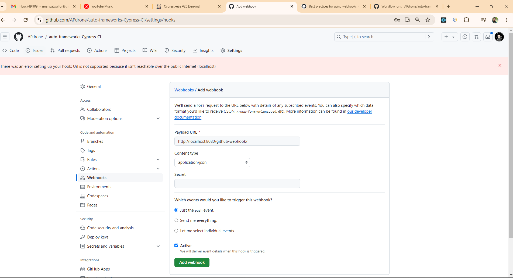
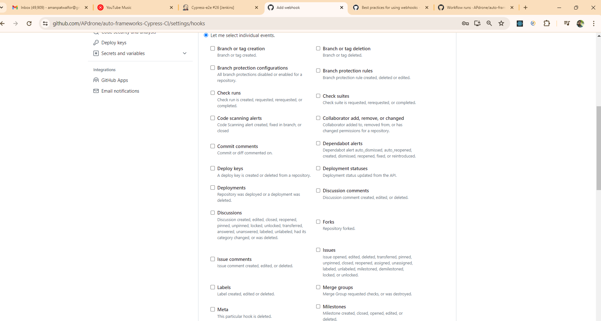
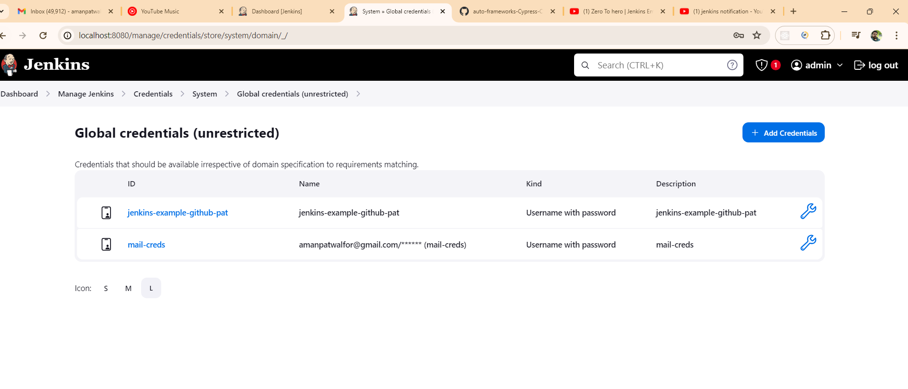
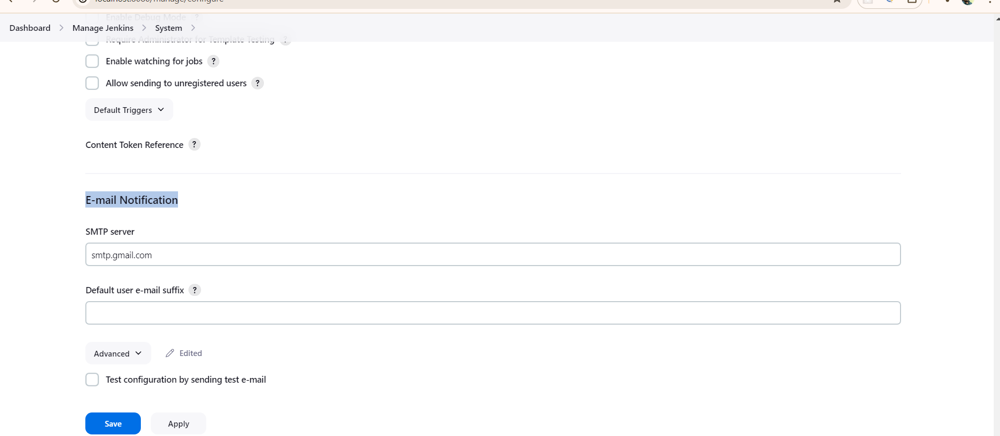

# Jenkins CI/CD Pipeline Setup Guide

This guide details the integration steps for configuring Jenkins with this Cypress E2E automation framework.

---

## 1. Prerequisites
- Jenkins 2.x+ running with Docker / Local Server
- NodeJS Plugin installed in Jenkins
- HTML Publisher Plugin installed
- Extended Email Notification (`email-ext`) Plugin installed

---

## 2. GitHub Webhook Configuration
To automatically trigger the pipeline upon code commits or PR merges:

1. Navigate to your GitHub repository: **Settings** &rarr; **Webhooks** &rarr; **Add webhook**.
2. Configure Payload URL:
   ```text
   http://<your-jenkins-host>:8080/github-webhook/
   ```
3. Set Content type to `application/json`.
4. Under event triggers, choose **Just the push event** or select specific PR / push actions.


*Figure 1: GitHub Webhook URL and payload setup.*


*Figure 2: Granular event triggers for automated regression testing.*

---

## 3. Jenkins Credentials Setup
In Jenkins dashboard: **Manage Jenkins** &rarr; **Credentials** &rarr; **System** &rarr; **Global credentials**:

- **GitHub Personal Access Token (PAT)**: Required for private repo checkouts and PR status updates.
- **SMTP Mail Credentials**: For automated email status reports upon test completion.


*Figure 3: Global credentials for GitHub and SMTP relay.*

---

## 4. SMTP Email Notification Configuration
To receive automated HTML reports on pipeline completion:

1. Navigate to: **Manage Jenkins** &rarr; **System** &rarr; **Extended E-mail Notification**.
2. Configure SMTP Server: `smtp.gmail.com` (Port 465 or 587).
3. Use Google App Passwords for authentication.


*Figure 4: SMTP server and notification preferences in Jenkins.*

---

## 5. Jenkins HTML Report CSP Fix
If Mochawesome CSS styles do not render properly inside Jenkins due to Content Security Policy (CSP), execute the following in **Manage Jenkins** &rarr; **Script Console**:

```groovy
System.setProperty("hudson.model.DirectoryBrowserSupport.CSP", "")
```
